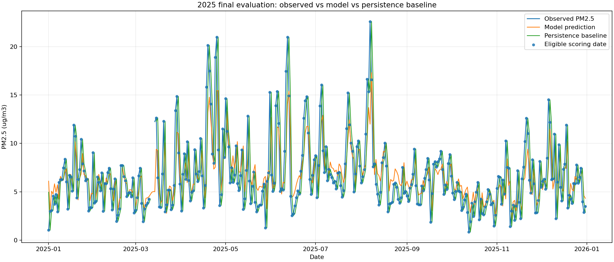

# Predicting Next-Day PM2.5 at the Albemarle Monitoring Site

DS 4002 Project 2 | EAZ Inc. | Annie Nguyen (group leader), Zilan Saadi, Eli Boyden

We forecast the next day's average PM2.5 at EPA site **51-003-0001**, Albemarle High School, Virginia. The goal is **2025 test MAE at least 10% below** a baseline that predicts tomorrow equals today.

**All three stages are implemented: preprocessing, training/validation, and final evaluation.** The frozen selected model is **corrected-history ARIMA(2,1,3), without filling**, refitted on 2021-2024. On **361 shared 2025 scoring dates**, model MAE is **2.024619 ug/m3**, baseline MAE **2.295626 ug/m3**, an **11.805358% reduction**. The goal is met on this retrospective test.

## Repository contents

- [Script and output file guide](output/README.md): what every script does, what each result file contains, and which files to use for the presentation.

- [Data metadata](data/README.md): access, provenance, terms, ethics, original/derived dictionaries, missingness, and two exploratory plots.
- [Selection and results](output/model_selection.md): model comparisons, diagnostics, changes from MI2, and final evaluation.
- [Final evaluation](output/final_evaluation/evaluation_summary.md): test protocol and result.
- [Reproduction check](output/reproducibility_check.md): clean-environment verification and its limits.
- `LICENSE.md`: MIT terms for team-authored work; source data retain applicable terms.

## 1. Software and platform

Tested on **Windows, CPython 3.14.7**, with VS Code/PowerShell/Git. The notebooks and modeling scripts require numpy 2.5.3, pandas 3.0.5, scipy 1.18.1, statsmodels 0.15.0, and matplotlib 3.11.1. Optional notebook use is supported by ipykernel 7.3.0. Python's pathlib, csv, json, zipfile, hashlib, warnings, and itertools are standard-library modules; do not install them separately.

`requirements.txt` pins direct dependencies including notebook support. **`requirements-lock.txt` pins all 45 resolved packages from the tested Windows environment**, including transitive dependencies. Use the lock file for closest reproduction. Other operating systems/Python versions are not tested; Windows-specific packages in the lock may require adaptation. Exact numerical equality across different numerical-library/platform combinations is not promised. The saved pickle is version-sensitive; use matching versions or rebuild it with the refit script. Load only trusted team-created pickle files.

### Confirmed environment: both preprocessing notebooks

Both `scripts/preprocessing_with_interpolation.ipynb` and `scripts/preprocessing_without_interpolation.ipynb` reported the same environment:

```text
Python: 3.14.7 (tags/v3.14.7:823f032, Aug  5 2026, 10:51:32) [MSC v.1944 64 bit (AMD64)]
numpy==2.5.3
pandas==3.0.5
scipy==1.18.1
statsmodels==0.15.0
matplotlib==3.11.1
ipykernel==7.3.0
```

These are the reported installed versions; both preprocessing notebooks import pandas and NumPy, plus Python standard-library modules. The without-interpolation notebook leaves missing values blank. Despite its filename, the with-interpolation notebook performs forward filling, not linear interpolation.

## 2. Documentation map

```text
DS4002-project2/
|-- README.md
|-- LICENSE.md
|-- requirements.txt
|-- requirements-lock.txt
|-- .gitignore
|-- scripts/
|   |-- preprocessing_without_interpolation.ipynb # Original detailed corrected-history notebook
|   |-- preprocessing_with_interpolation.ipynb    # Original detailed forward-fill notebook
|   |-- model_training.py                        # Step 2: 152 candidate comparisons
|   |-- validation_models.py                     # Imported helper, not a standalone step
|   |-- model_diagnostics.py                     # Step 3: selected model checks
|   |-- refit_selected_model.py                  # Step 4: frozen-model refit
|   `-- evaluation.py                            # Step 5: 2025 test
|-- data/
|   |-- README.md
|   |-- raw/
|   |   |-- README.md
|   |   `-- daily_88101_2021.zip ... daily_88101_2025.zip
|   `-- processed/
|       |-- albemarle_pm25_poc3_without_interpolation.csv
|       |-- albemarle_pm25_corrected_poc_without_interpolation.csv
|       |-- albemarle_pm25_poc3_forward_filled.csv
|       `-- albemarle_pm25_corrected_poc_forward_filled.csv
`-- output/
    |-- README.md                                # Script/output file guide
    |-- model_selection.md
    |-- reproducibility_check.md
    |-- split_summary.csv / training_lag_correlations.csv
    |-- validation_{fit_log,model_comparison,predictions}.csv
    |-- validation_selection.json
    |-- {poc,gap_filling}_comparison_{all_models,best_by_family}.csv
    |-- original_poc3/                            # Same four validation files
    |-- original_poc3_forward_filled/             # Same four validation files
    |-- corrected_forward_filled/                # Same four validation files
    |-- figures/
    |   |-- training_pm25_over_time.png
    |   |-- training_pm25_distribution.png
    |   |-- training_lag_correlations.png
    |   |-- validation_predictions.png
    |   `-- poc_comparison_predictions.png
    |-- diagnostics/
    |   |-- diagnostic_summary.json / training_model_summary.txt
    |   |-- selected_model_diagnostics.png
    |   |-- validation_errors.csv / validation_largest_errors.csv
    |   `-- validation_{monthly_errors,error_lag_correlations}.csv
    |-- final_model/
    |   |-- corrected_poc_arima_2_1_3_without_interpolation.pkl
    |   |-- fitted_parameters.csv / refit_history_2021_2024.csv
    |   |-- refit_metadata.json / refit_summary.txt
    |   `-- requirements.txt                      # Refit-only historical environment
    `-- final_evaluation/
        |-- evaluation_predictions.csv / evaluation_metrics.json
        |-- evaluation_summary.md
        `-- evaluation_plot.png
```

Empty `.gitkeep` files retain directory structure and are not datasets. Each alternative validation directory contains `validation_fit_log.csv`, `validation_model_comparison.csv`, `validation_predictions.csv`, and `validation_selection.json`.

## 3. Instructions for reproducing results

### Create a clean environment

Install CPython **3.14.7** (64-bit) and Git. Clone the repository and open PowerShell at its root:

```powershell
git clone https://github.com/nguyena221/DS4002-project2.git
cd DS4002-project2
py -3.14 -m venv .venv
.\.venv\Scripts\python.exe -m pip install -r requirements-lock.txt
.\.venv\Scripts\python.exe -m pip check
```

Confirm `py -3.14 --version` reports 3.14.7. If using an explicit Python executable instead of the launcher, substitute its path for `py -3.14`. Activation is unnecessary when invoking `.venv/Scripts/python.exe` directly. The isolated environment prevents accidental reliance on globally installed packages.

### Reproduce with the original notebooks and scripts

All five raw ZIPs are included. No account, API key, scraping, or new download is needed. First run the two notebooks as described in step 1 below. Then run these commands **in order**, from the repository root:

```powershell
.\.venv\Scripts\python.exe scripts/model_training.py
.\.venv\Scripts\python.exe scripts/model_diagnostics.py
.\.venv\Scripts\python.exe scripts/refit_selected_model.py
.\.venv\Scripts\python.exe scripts/evaluation.py
```

1. **Preprocessing uses the original detailed notebooks.** Before running the terminal commands above, open `scripts/preprocessing_without_interpolation.ipynb` in VS Code, select the `.venv` Python kernel, restart it, and run all cells in order. It reads the five raw ZIPs and regenerates `albemarle_pm25_corrected_poc_without_interpolation.csv`. The supplied `albemarle_pm25_poc3_without_interpolation.csv` is the original-history comparison reference and is not regenerated by that notebook. Next, open `scripts/preprocessing_with_interpolation.ipynb`, restart the same kernel, and run all cells. It requires both no-fill reference CSVs, verifies their pollution values, and generates the two forward-filled CSVs. Despite the filename, this notebook uses forward filling, not linear interpolation. The original notebooks are unchanged. Their default pandas parsing imports EPA's literal Event Type None as a null; this does not mean the associated PM2.5 observation is missing. The remaining terminal commands run training, diagnostics, refit, and evaluation in that order.

2. **Training/validation** uses 2021-2023 for fitting and 2024 for selection. It runs 32 nonseasonal candidates (p/q 0-3, d 0-1) and six exploratory weekly candidates for each of four datasets: **152 candidate fits**. The helper module is imported automatically. Fits can take several minutes; progress is printed and logged. Nonconverged fits are excluded and documented.
3. **Diagnostics** checks the selected corrected/no-fill model, including warnings, error patterns, root magnitudes, and plots. Diagnostics do not trigger test-based retuning.
4. **Refit** fixes ARIMA(2,1,3), no seasonal terms or drift, and fits 2021-2024. It saves parameters, filtered state, metadata, model/history checksums, and package versions. Missing observations remain blank. The script deliberately stops if the recorded model selection changes.
5. **Evaluation** loads the matching trusted model after verifying its checksum/end date. It predicts each day of 2025 before incorporating that day's observation, then updates state without changing fitted parameters. It writes predictions, metrics, plot, and summary. This recreates the already-frozen test, not a new tuning opportunity.

Reruns overwrite generated files. Original ZIPs remain unchanged. To inspect the completed results without refitting, read `output/final_evaluation/evaluation_metrics.json` and its plot. To rerun only the test with included artifacts, run the last command after installing dependencies.

## Analysis choices and results

Use the selected site's `1 HOUR` daily summaries, >=18 observations/day, one eligible record per date, and a complete calendar. The corrected history combines POC 23/method 736 before August 1, 2023 with POC 3/method 636 afterward, following EPA's measurement documentation [1], [2]. It differs from original POC 3 at 892 older measured values, with identical gaps and later values.

The four-way validation comparison tests original/corrected histories with/without forward filling. For d=0, nonseasonal models include a constant; d=1 uses no drift. Weekly candidates use nonseasonal orders (1,0,0)/(1,0,1) crossed with seasonal orders (1,0,0,7)/(0,0,1,7)/(1,0,1,7). These six candidates are a limited seasonal comparison, not an exhaustive seasonal search.

Forecasts are one step ahead, using the default predicted/filtering information set [3]. Prior validation observations update model state; parameters stay fixed. All approaches use the same **349 observed validation dates** with an observed previous calendar day for baseline comparison. Filled values are inputs only, never actual targets/baseline answers. Forecasts are not clipped.

| Dataset | Gap handling | Best ARIMA validation MAE | Best weekly SARIMA validation MAE |
| --- | --- | ---: | ---: |
| Corrected | Leave missing | **2.054515** | 2.067389 |
| Original POC 3 | Leave missing | 2.054891 | 2.128212 |
| Corrected | Forward fill | 2.058953 | 2.065437 |
| Original POC 3 | Forward fill | 2.060431 | 2.122653 |

Shared validation baseline MAE: **2.274375 ug/m3**. Selected corrected/no-fill ARIMA(2,1,3) improves validation MAE by **9.666857%**. The original/no-fill approach is nearly tied; this is not evidence of a substantial accuracy gain from correction. Corrected history also has an independent measurement-quality rationale [1], [2]. Forward filling did not improve the best overall result.

After selection, refitting uses **1,461 calendar days, 1,397 measured and 64 missing** in 2021-2024. The **2025 test has 365 calendar days, 362 measured days, and 361 scoring dates**. March 11-13 have missing targets; March 14 is observed but cannot be scored against an observed previous-day baseline. December 31, 2024 supplies the baseline for January 1, 2025.

| Final 2025 metric | Value |
| --- | ---: |
| Model MAE (ug/m3) | 2.024619 |
| Persistence MAE (ug/m3) | 2.295626 |
| Improvement: 100 * (baseline MAE - model MAE) / baseline MAE | 11.805358% |
| Target: at least 10% improvement | **Met** |



## Changes from MI2 and limitations

- Replaced original POC-3-only history with EPA-corrected older history plus aligned later readings; original history remains a comparison.
- Compared causal forward filling instead of linear interpolation. Selected **no filling**, using state-space missing-observation handling on a regular calendar. No consecutive-period truncation was needed.
- Specified the limited weekly seasonal candidates and documented excluded fits.
- Selected on 2024 only and kept that choice fixed for the already-completed 2025 test. Regenerating these results does not justify further test-driven tuning.
- Retrospectively revised data are not identical to real-time data availability. Results concern one site/year. Diagnostics show sudden-change misses, non-normal training errors, and a moving-average root near its invertibility boundary. A near-zero mean signed error does not imply small individual errors. No confidence interval or significance test establishes universal superiority.

## Team responsibilities

| Member | Main responsibility |
| --- | --- |
| Zilan Saadi | Source-data selection, preprocessing, missingness, and data documentation |
| Annie Nguyen (group leader) | Training/validation, model selection, diagnostics/refit, and coordination |
| Eli Boyden | Final 2025 evaluation, MAE/baseline comparison, and result outputs |

## References

[1] U.S. Environmental Protection Agency, "U.S. EPA Quick Reference Guide to T640/T640X Data," May 13, 2024. [Online]. Available: https://www.epa.gov/system/files/documents/2024-05/quick-reference_t640-data_final_05-13-2024.pdf. [Accessed: Oct. 23, 2026].

[2] U.S. Environmental Protection Agency, "Supplemental Information on the EPA's Update of PM2.5 Data from T640/T640X PM Mass Monitors," May 13, 2024. [Online]. Available: https://www.epa.gov/system/files/documents/2024-05/2_supplemental-info_t640-data-update_final-05-13-2024.pdf. [Accessed: Oct. 23, 2026].

[3] Statsmodels Developers, "SARIMAXResults.extend." [Online]. Available: https://www.statsmodels.org/stable/generated/statsmodels.tsa.statespace.sarimax.SARIMAXResults.extend.html. [Accessed: Oct. 23, 2026].
