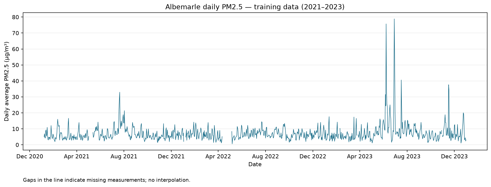
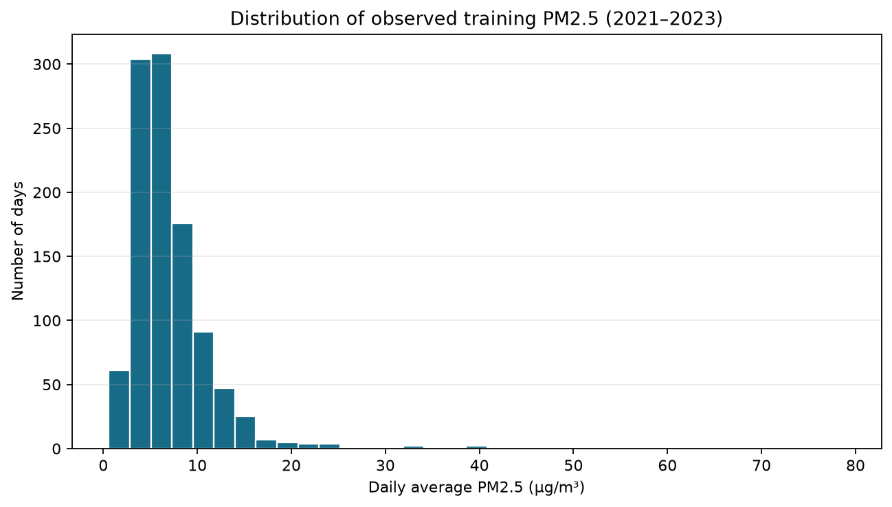

# Dataset metadata

## Data summary and access

All data needed to reproduce this project are included here: five original EPA ZIPs in [raw/](raw/) and four derived CSVs in [processed/](processed/). The ZIPs contain 4,000,854 nationwide daily-summary records for PM2.5 parameter 88101 in 2021-2025. Filtering to site **51-003-0001**, Albemarle High School, produces 5,595 records across 1,791 dates before monitor/summary selection. These are summaries, not 5,595 independent daily concentrations.

The final analyzed dataset is [albemarle_pm25_corrected_poc_without_interpolation.csv](processed/albemarle_pm25_corrected_poc_without_interpolation.csv). It has **1,826 calendar rows, 1,759 measured values, and 67 missing PM2.5 values**. One row is one local calendar day. Concentrations are in micrograms per cubic meter at local conditions (ug/m3). Missingness includes unavailable readings and days excluded by the >=18-hourly-observation rule; blank days are not zero.

| Year | Calendar days | Measured days | Missing days |
| --- | ---: | ---: | ---: |
| 2021 | 365 | 348 | 17 |
| 2022 | 365 | 337 | 28 |
| 2023 | 365 | 359 | 6 |
| 2024 | 366 | 353 | 13 |
| 2025 | 365 | 362 | 3 |

## Provenance and selection

The group downloaded the annual ZIPs directly from EPA AirData [1]. Monitoring agencies report measurements to EPA's Air Quality System; EPA calculates the daily summaries [2]. Exact original download dates were not recorded and are not inferred from file timestamps. [preprocessing_audit.json](processed/preprocessing_audit.json) records original filenames, URLs, SHA-256 checksums, and row counts.

Zilan prepared the original preprocessing notebooks. The shared `scripts/preprocess_data.py` now reproduces all four CSVs without manual edits. Keep parameter 88101 and `1 HOUR` summaries at this site. The label identifies the underlying sampling duration; Arithmetic Mean is already a daily average. Require >=18 hourly observations. Prefer Included over None over Excluded for repeated eligible dates, then keep one row per date. Preserve the complete calendar. Literal Event Type `None` is a category; an empty calendar row has no measurement or event metadata.

The corrected history uses **POC 23/method 736 before 2023-08-01** and **POC 3/method 636 from that date onward**. EPA identifies 736 as retrospectively corrected history and 636 as collection-time Network Data Alignment [3], [4]. The original comparison uses POC 3 throughout, with method 236 before the change and 636 afterward. Both histories have identical missing dates and identical measurements from August 2023 onward; **892 older usable values differ**. No correction formula is calculated by this project.

Event labels differ between measurement versions. Original records retained by EPA can be excluded from regulatory use; this alone does not prove a wildfire or other physical event. We do not infer causes from these flags. Retrospectively revised history does not recreate which revisions were available in real time in 2021-2023.

## Derived datasets and missing-data experiments

| File under processed/ | History | Gap handling |
| --- | --- | --- |
| albemarle_pm25_corrected_poc_without_interpolation.csv | Corrected | Selected final dataset; leave 67 gaps blank |
| albemarle_pm25_poc3_without_interpolation.csv | Original POC 3 | Leave 67 gaps blank |
| albemarle_pm25_corrected_poc_forward_filled.csv | Corrected | Forward-fill model inputs only |
| albemarle_pm25_poc3_forward_filled.csv | Original POC 3 | Forward-fill model inputs only |

Each filled experiment supplies **61 values** and retains **six leading blanks**. Forward filling repeats the latest past observation; it is not linear interpolation. It repeats readings even across long gaps and cannot recover unobserved spikes. Actual targets remain in `PM2.5_Original`. Filled values are never treated as observed scoring targets or baseline answers. Validation selected the corrected no-fill approach. State-space filtering handles gaps while preserving calendar spacing. The final analysis therefore did not use linear interpolation or truncate to a consecutive period as proposed in MI2.

## Source terms and citation

EPA publishes these records for public download [1]. We did not identify a dataset-specific license on that page. EPA publication alone does not establish that every contributed record is a federal government work. EPA's general disclaimer distinguishes its own and third-party material and advises attention to metadata [5]. We credit EPA and reporting agencies and preserve provenance. The repository MIT license applies to team-authored code/documentation, not a new license for EPA source records. No broader claim of unrestricted rights is made.

## Ethical statement, uncertainty, and limitations

These are ambient pollution measurements, not personal records. Predictions are academic retrospective forecasts, not official public-health guidance. One site does not represent every person's exposure or all of Virginia. Instrument uncertainty is not supplied as a per-reading standard error; observation coverage measures completeness, not precision. Missing periods, method changes, historical revisions, pollution spikes, and forecast errors limit interpretation. Do not treat estimated inputs as measurements. Report test performance without test-driven retuning.

## Initial-data dictionary (29 EPA fields)

Types describe parsed meanings; CSV itself has no enforced types. Preserve leading zeroes when treating geographic codes as strings. Blank fields and category `None` must remain distinguishable [2].

| Field | Type | Meaning / units |
| --- | --- | --- |
| State Code | Identifier | State FIPS; 51 here |
| County Code | Identifier | County FIPS; 003 here |
| Site Num | Identifier | Site within county; 0001 here |
| Parameter Code | Identifier | Pollutant; 88101 |
| POC | Identifier | Parameter occurrence code distinguishing monitors at a site |
| Latitude | Float | Decimal degrees north |
| Longitude | Float | Decimal degrees east; negative here |
| Datum | String | Coordinate reference datum, WGS84 |
| Parameter Name | String | PM2.5 - Local Conditions |
| Sample Duration | String | Duration of underlying sample or derived averaging interval |
| Pollutant Standard | Optional string | Regulatory summary rules; blank on selected 1 HOUR rows |
| Date Local | Date | Local measurement calendar date |
| Units of Measure | String | Micrograms/cubic meter (LC) |
| Event Type | Category | None, Included, Excluded; None is not missing |
| Observation Count | Integer | Number of underlying observations used |
| Observation Percent | Float | Percentage of expected observations obtained |
| Arithmetic Mean | Float | Daily mean concentration |
| 1st Max Value | Float | Highest underlying value in this summary |
| 1st Max Hour | Integer | Local hour associated with maximum |
| AQI | Optional integer | Air Quality Index; blank on selected 1 HOUR rows |
| Method Code | Identifier | EPA method code |
| Method Name | String | Measurement/analysis method description |
| Local Site Name | String | Albemarle High School |
| Address | String | Site location description |
| State Name | String | Virginia |
| County Name | String | Albemarle |
| City Name | String | Not in a city (legal city boundaries) |
| CBSA Name | String | Charlottesville, VA metropolitan area |
| Date of Last Change | Date | AQS record update date, not download date |

For the 5,595 site rows, Pollutant Standard and AQI each have 2,684 empty fields; other columns have no empty strings. Event Type has 3,793 None, 1,800 Included, and two Excluded records. These counts describe all site summary types before final selection, not nationwide records.

## Final and experimental data dictionary

| Column | Type | Meaning / missingness |
| --- | --- | --- |
| Date | Date | Complete daily calendar; never missing or duplicated |
| PM2.5 | Float | Daily observed ug/m3; 67 blanks in no-fill files; filled input in experiments |
| Observation_Count | Numeric count | Hourly readings; blank on unmeasured dates |
| Observation_Percent | Float | Completeness, not standard error; blank on unmeasured dates |
| Event_Type | Category | Selected source category; metadata blank on unmeasured dates |
| Method_Code | Identifier | 736/636 corrected; 236/636 original; blank on unmeasured dates |
| Method_Name | String | Selected method description; blank on unmeasured dates |
| PM2.5_Original | Float | Filled files only: observed series, preserving 67 blanks |
| Was_Filled | Boolean | Filled files only: true if supplied by forward filling |
| Fill_Source_Date | Date | Filled files only: latest observed source date; own date on measured rows; six leading blanks |

No-fill files contain the first seven columns; filled files add the last three. Measurement metadata is not fabricated on filled days. The POC selection is documented above, not an additional export column.

## Explanatory plots

These plots use observed **2021-2023 training data only**. The first shows changes and gaps; the second shows a right-skewed distribution with occasional high values. Neither proves seasonality or identifies causes.

## References

[1] U.S. Environmental Protection Agency, "AirData Download Files." [Online]. Available: https://aqs.epa.gov/aqsweb/airdata/download_files.html. [Accessed: Oct. 23, 2026].

[2] U.S. Environmental Protection Agency, "AirData Download Files Documentation," Dec. 1, 2015. [Online]. Available: https://aqs.epa.gov/aqsweb/airdata/FileFormats.html. [Accessed: Oct. 23, 2026].

[3] U.S. Environmental Protection Agency, "U.S. EPA Quick Reference Guide to T640/T640X Data," May 13, 2024. [Online]. Available: https://www.epa.gov/system/files/documents/2024-05/quick-reference_t640-data_final_05-13-2024.pdf. [Accessed: Oct. 23, 2026].

[4] U.S. Environmental Protection Agency, "Supplemental Information on the EPA's Update of PM2.5 Data from T640/T640X PM Mass Monitors," May 13, 2024. [Online]. Available: https://www.epa.gov/system/files/documents/2024-05/2_supplemental-info_t640-data-update_final-05-13-2024.pdf. [Accessed: Oct. 23, 2026].

[5] U.S. Environmental Protection Agency, "EPA Disclaimers." [Online]. Available: https://www.epa.gov/web-policies-and-procedures/epa-disclaimers. [Accessed: Oct. 23, 2026].
